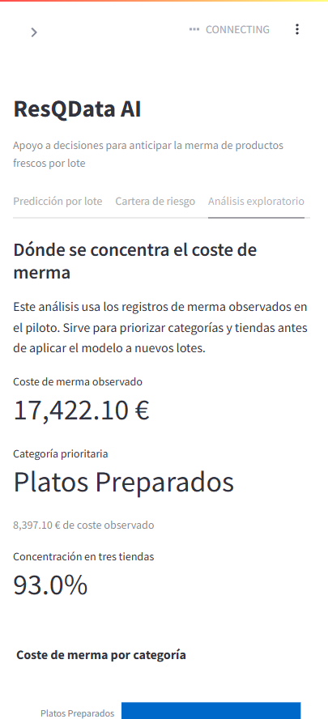
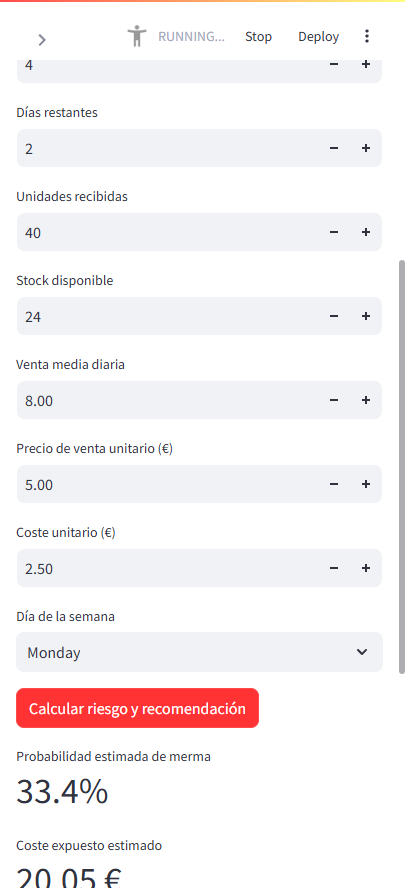

# ResQ Intelligence

ResQ Intelligence es una plataforma B2B para convertir datos empresariales en decisiones de demanda, inventario y rentabilidad. Una empresa puede cargar sus CSV, revisar su calidad, detectar riesgos operativos y comparar escenarios económicos con supuestos visibles.

El caso FreshMarket se conserva como demostración especializada de perecederos. Está identificado como piloto sintético y no se presenta como operación real.

## Pregunta de negocio

> ¿Qué decisiones debe priorizar una empresa para proteger su margen a partir de su demanda, inventario y costes?

## Capacidades

- Carga de CSV y Excel de ventas, inventario, costes y proveedores, además de una carga libre que conserva todas las columnas para EDA.
- Mapeo de alias como `fecha`, `sku`, `producto`, `unidades` o `coste`.
- Detección de campos ausentes, fechas o números inválidos, negativos y duplicados.
- EDA empresarial con filtros por periodo y producto, medias móviles, ranking de productos, distribución, patrones temporales, calidad y hallazgos con límites explícitos.
- Chat contextual sobre ResQ y los datos de sesión, ejecutado exclusivamente mediante Ollama local.
- EDA avanzado reutilizable: perfilado, nulos, duplicados, valores negativos, distribuciones, atípicos, correlaciones, anomalías temporales, bootstrap, deriva y segmentación exploratoria.
- Cobertura de inventario, riesgo de rotura, sobrestock y capital expuesto.
- Riesgo por lote opcional para empresas con stock por lote y fecha límite, expresado como proporción estimada de stock sin vender, no como probabilidad calibrada.
- Simulador de escenarios de precio, volumen y coste de almacenamiento.
- Previsión de demanda evaluada con datos reales de FreshRetailNet-50K.
- Caso vertical FreshMarket: riesgo de merma por lote, descuentos y donación.

## Contratos de datos

La plataforma no exige un esquema único ni datos de caducidad. Cada módulo se activa solo cuando los datos cargados lo permiten:

- [Plantillas y contratos](docs/06_contratos_de_datos.md).
- [Plantillas CSV](data/templates/).
- [Informe acumulativo para GPT](docs/INFORME_POR_FASES_PARA_GPT.md).
- [Guion para la presentación](docs/04_guion_presentacion.md) y [lista de comprobación](docs/05_lista_de_comprobacion.md).

## Datos y transparencia

| Fuente | Uso | Naturaleza |
|---|---|---|
| FreshRetailNet-50K | Evaluación de previsión de demanda. | Datos reales, licencia CC BY 4.0. |
| FreshMarket | Caso vertical de merma por lote. | Piloto sintético incluido en el repositorio. |
| Eurostat `cei_pc035` | Contexto del caso alimentario. | Indicador público agregado. |

La documentación de la fuente real, el método temporal, métricas y límites está en [07_datos_reales_y_demanda.md](docs/07_datos_reales_y_demanda.md).

No se afirma que FreshRetailNet-50K incluya costes internos, caducidades o mermas de una empresa usuaria. Los cálculos de escenarios son estimaciones y nunca ahorros realizados.

## Aplicación

La app usa una navegación lateral y una portada con indicadores condicionales: cada cifra aparece solo si hay datos suficientes para calcularla.

1. **Inicio**: resume ventas, margen estimado, capital y lotes prioritarios cuando los datos permiten calcularlos.
2. **Datos y calidad**: importa CSV o Excel por contrato o conserva todas las columnas mediante la carga libre para EDA.
3. **Análisis exploratorio**: alterna entre el EDA empresarial —resumen, productos, distribución, temporalidad, calidad y hallazgos— y el EDA avanzado reutilizable.
4. **Demanda**: muestra la evaluación reproducible sobre FreshRetailNet-50K.
5. **Inventario y rentabilidad**, **Riesgo por lote** y **Escenarios**: muestran indicadores o estimaciones con requisitos y límites visibles.
6. **Fuentes**: identifica la procedencia y naturaleza de los conjuntos de datos de la sesión.
7. **Informe**: descarga un resumen Markdown de calidad, resultados disponibles, fuentes, supuestos y limitaciones; no exporta filas originales.
8. **Metodología**: explica los cálculos y las conclusiones que no deben inferirse.

El EDA avanzado solo activa cada técnica si la muestra y los tipos de datos la justifican. El bootstrap exige 10 observaciones y asume independencia; no debe usarse como incertidumbre temporal cuando existe autocorrelación. La deriva requiere 20 observaciones en cada periodo; la segmentación exige dos variables numéricas y una muestra suficiente. Las fechas se agregan a día y los valores extremos se incluyen en el PSI. Sus resultados describen patrones y limitaciones: no demuestran causalidad ni sustituyen un modelo predictivo evaluado.

### Asistente local de ResQ

El panel lateral **Chat sobre ResQ** responde preguntas sobre la aplicación, su metodología documentada y los datos cargados en la sesión. Usa Ollama en `localhost`; el código rechaza hosts remotos para que el contexto no salga del equipo. El modelo debe estar instalado localmente:

```powershell
ollama serve
ollama pull qwen3.6:latest
```

Si Ollama ya está ejecutándose, no hace falta iniciar otro servicio. La app detecta los modelos al pulsar **Conectar con Ollama**. Puede seleccionarse otro modelo con `OLLAMA_MODEL`. El contexto incluye todas las filas solo para conjuntos de hasta 20 filas y 15 columnas, con un máximo de 2.500 caracteres; para tablas mayores usa perfiles y una muestra de hasta 8 filas. Por ello, ante preguntas que requieran recorrer todos los registros de una tabla grande, el asistente debe indicar la limitación en lugar de presentar una respuesta como exacta.

### Demostración lista para ejecutar

En **Cargar datos empresa**, pulsa **“Cargar demostración con demanda real”**. El botón activa automáticamente:

- ventas reales derivadas de FreshRetailNet-50K;
- un inventario, costes y lote de escenario para mostrar todas las vistas de la app;
- EDA empresarial, inventario, escenarios y riesgo por lote.

Las ventas proceden de la fuente real documentada. El inventario, los costes y la fecha límite se etiquetan como supuestos de escenario porque FreshRetailNet-50K no publica esos datos internos.





## Ejecución local

Requiere Python 3.11 o superior.

```powershell
python -m pip install -r requirements.txt
streamlit run app.py
```

El caso FreshMarket genera sus artefactos locales si faltan. La app no almacena los CSV cargados por una empresa fuera de la sesión del navegador.

## Regenerar evidencias

```powershell
python -m src.fetch_eurostat_context
python -m src.data_pipeline
python -m src.train_model
python -m src.real_demand
```

Para regenerar la evaluación real, descarga antes las dos particiones oficiales de FreshRetailNet-50K en `data/external/freshretailnet/`, tal como se explica en [07_datos_reales_y_demanda.md](docs/07_datos_reales_y_demanda.md).
La lectura de esos archivos Parquet requiere `pyarrow`, incluido en `requirements.txt`. El ZIP seguro para revisión de GPT excluye deliberadamente estos datos externos y no es un paquete ejecutable completo.

## Verificación

```powershell
python -m pytest -q
```

## Despliegue

La aplicación está preparada para Streamlit Community Cloud con Python 3.11 y `app.py` como archivo principal. La publicación permanece pendiente de autorización expresa.
